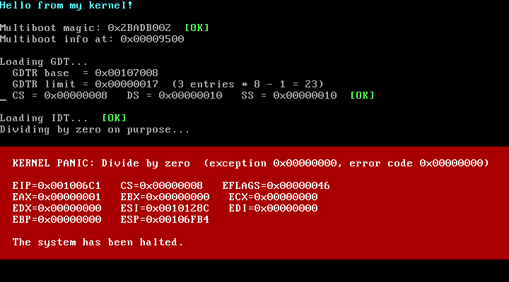

# x86 Kernel from Scratch

A 32-bit x86 kernel written from scratch in C and NASM Assembly, built one section at a time.
Every section comes with a PDF that walks through the concepts, the code, and the result.



## Progress

| # | Section | Status | Write-up |
|---|---------|--------|----------|
| 1 | Booting (Multiboot) & VGA text output | ✅ Done | [PDF](docs/01-boot-and-vga.pdf) |
| 2 | GDT (Global Descriptor Table) | ✅ Done | [PDF](docs/02-gdt.pdf) |
| 3 | IDT & CPU exceptions | ✅ Done | [PDF](docs/03-idt.pdf) |
| 4 | PIC, IRQs & keyboard driver | ⏳ Next | |
| 5 | Paging & memory management | | |

## Build & run

Requirements (Ubuntu / WSL):

```bash
sudo apt install build-essential gcc-multilib nasm qemu-system-x86 make
```

```bash
make          # build build/kernel.bin
make run      # boot it in QEMU
make debug    # log interrupts, don't reboot on triple fault
make clean
```

## Layout

```
src/boot.asm     Multiboot header, stack, _start entry point
src/kernel.c     kernel_main()
src/vga.c        VGA text-mode driver
src/gdt.c        Global Descriptor Table setup
src/gdt_flush.asm  lgdt + segment register reload
src/idt.c        Interrupt Descriptor Table
src/interrupts.asm  entry stubs for exceptions and IRQs
src/isr.c        exception handler / kernel panic screen
include/         headers
linker.ld        memory layout (kernel loaded at 1 MB)
docs/            per-section write-ups (PDF)
```
