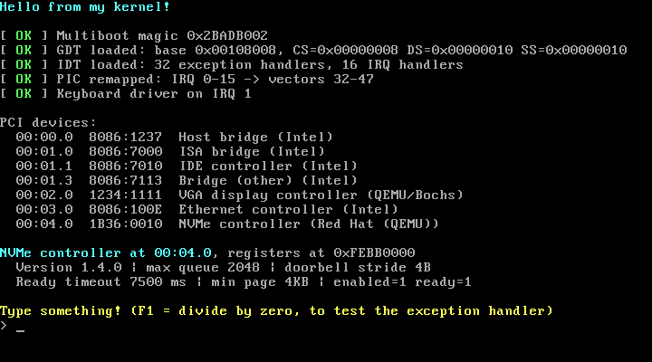

# x86 Kernel from Scratch

[](https://github.com/basillt/x86-kernel/actions/workflows/tests.yml)

A 32-bit x86 kernel written from scratch in C and NASM Assembly, built one part at a time.
Every part comes with a PDF write-up: what I learned, the code that matters, and what it looked like when it worked.

Right now it boots, sets up its own GDT and IDT, shows a panic screen on CPU exceptions, has an interrupt-driven
keyboard driver, scans the PCI bus, and reads the registers of an NVMe SSD controller. An automated test suite
boots it in QEMU on every push.



## Progress

| # | Part | Status | Write-up |
|---|------|--------|----------|
| 1 | Booting (Multiboot) & VGA text output | ✅ Done | [PDF](docs/01-boot-and-vga.pdf) |
| 2 | GDT (Global Descriptor Table) | ✅ Done | [PDF](docs/02-gdt.pdf) |
| 3 | IDT & CPU exceptions | ✅ Done | [PDF](docs/03-idt.pdf) |
| 4 | PIC, IRQs & keyboard driver | ✅ Done | [PDF](docs/04-keyboard.pdf) |
| 5 | PCI enumeration & NVMe controller registers | ✅ Done | [PDF](docs/05-pci-nvme.pdf) |
| 6 | Automated testing in QEMU (Python, CI) | ✅ Done | [PDF](docs/06-testing.pdf) |
| 7 | Timer (PIT) | ⏳ Next | |
| 8 | Paging | | |
| 9 | Memory allocator | | |
| 10 | Simple shell | | |

## Build & run

Requirements (Ubuntu / WSL):

```bash
sudo apt install build-essential gcc-multilib nasm qemu-system-x86 make
```

```bash
make            # build build/kernel.bin
make run        # boot it in QEMU
make run-nvme   # boot with a virtual NVMe SSD attached
make test       # run the automated tests (headless)
make debug      # log interrupts, don't reboot on triple fault
make clean
```

On Windows without WSL, install QEMU (`winget install SoftwareFreedomConservancy.QEMU`) and boot a built `kernel.bin` directly:

```powershell
& "C:\Program Files\qemu\qemu-system-i386.exe" -kernel kernel.bin
```

## Tests

`tests/run_tests.py` boots the kernel with no window, presses keys through QEMU's monitor (`sendkey`), and copies
VGA text memory out of the VM (`pmemsave 0xB8000`) to check the exact screen contents:

```
  PASS  boot log shows every step OK                             0.2s
  PASS  GDT: CPU uses selectors 0x08 / 0x10                      0.2s
  PASS  PCI scan finds the standard QEMU devices                 0.2s
  PASS  NVMe controller is detected and its registers read       0.2s
  PASS  keyboard: typed text appears after the prompt            0.8s
  PASS  keyboard: Shift and Caps Lock                            0.8s
  PASS  keyboard: Backspace erases the last character            0.7s
  PASS  keyboard: Backspace can't erase the prompt               0.7s
  PASS  keyboard: Enter starts a new prompt line                 0.7s
  PASS  exception: F1 shows a divide-by-zero kernel panic        0.6s

10 passed, 0 failed
```

## Layout

```
src/boot.asm        Multiboot header, stack, _start entry point
src/kernel.c        kernel_main(): boot sequence and status log
src/vga.c           VGA text-mode driver (colors, scrolling, hardware cursor)
src/gdt.c           Global Descriptor Table
src/gdt_flush.asm   lgdt + segment register reload
src/idt.c           Interrupt Descriptor Table
src/interrupts.asm  entry stubs for exceptions and IRQs
src/isr.c           exception handler / kernel panic screen
src/pic.c           8259 PIC remapping, masking, EOI
src/irq.c           IRQ handler registration and dispatch
src/keyboard.c      PS/2 keyboard driver (scancodes, Shift, Caps Lock)
src/pci.c           PCI configuration space access and bus scan
src/nvme.c          NVMe controller detection, BAR decoding, CAP/VS registers
include/            headers (io.h has the in/out port helpers)
linker.ld           memory layout (kernel loaded at 1 MB)
tests/              automated QEMU tests
docs/               per-part write-ups (PDF) and screenshots
```
